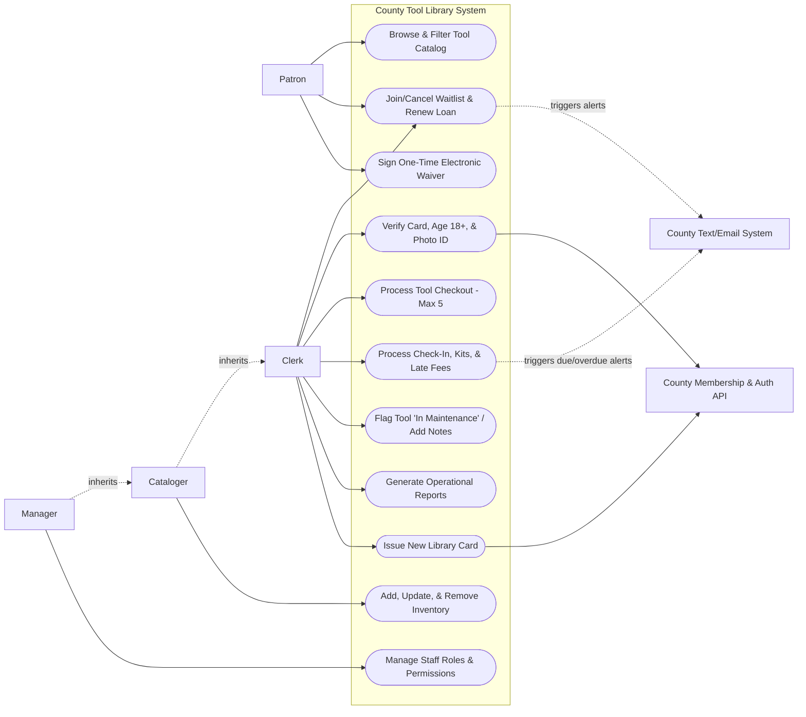
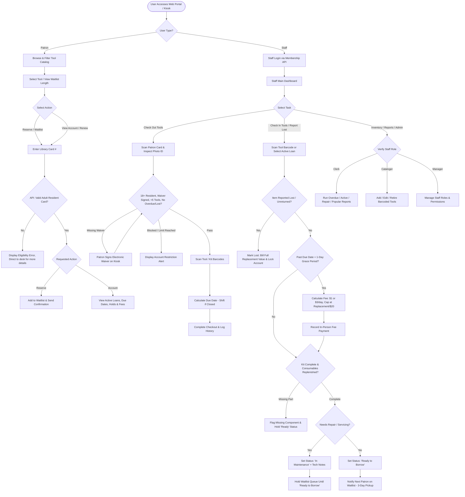
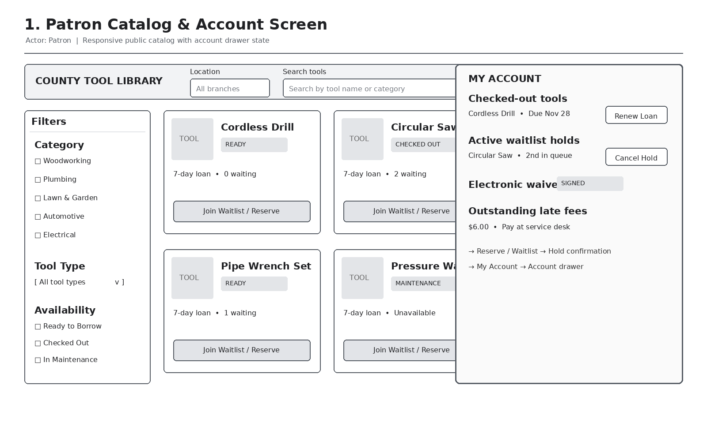
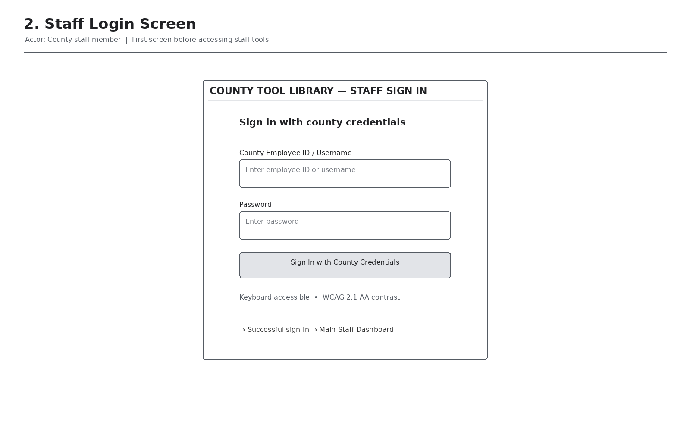
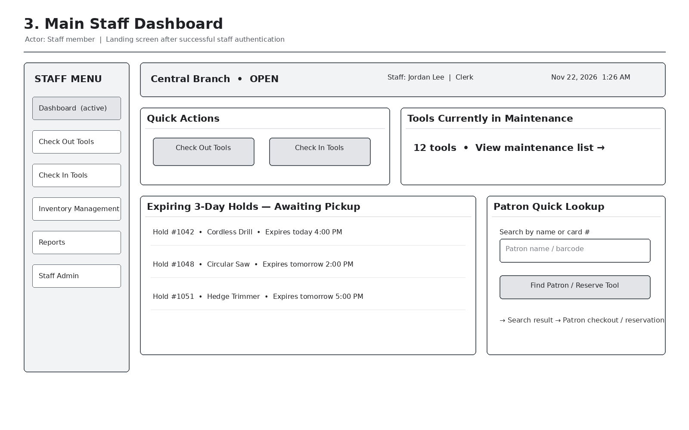
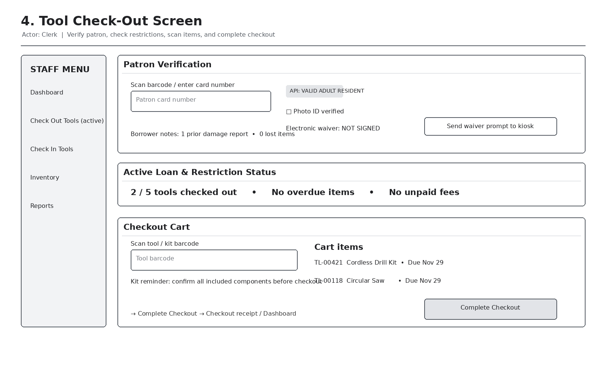
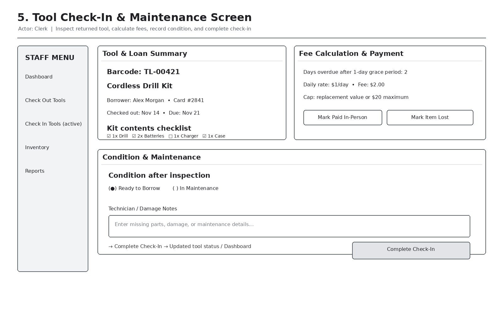
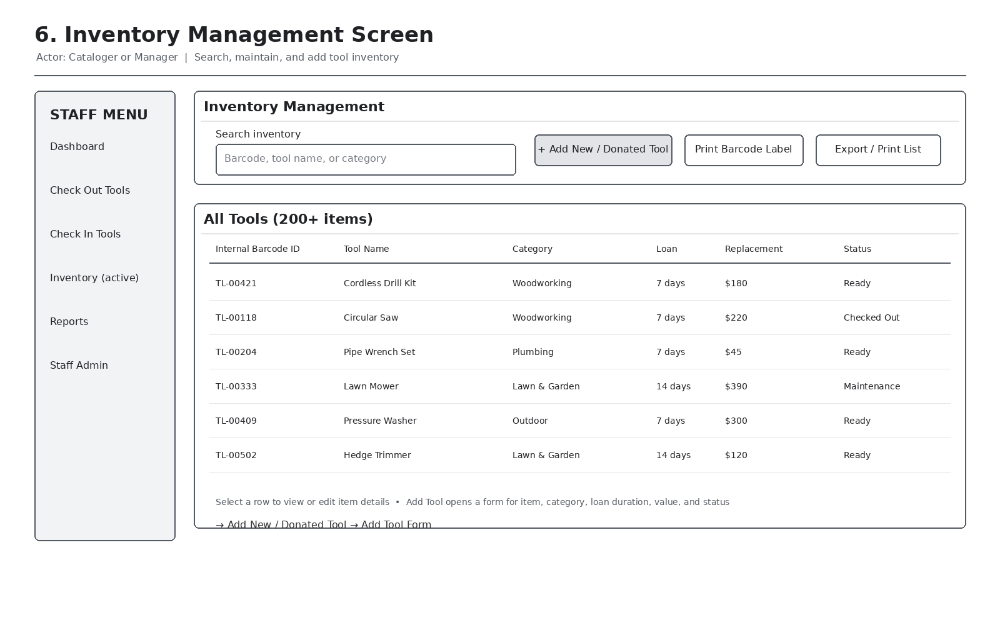
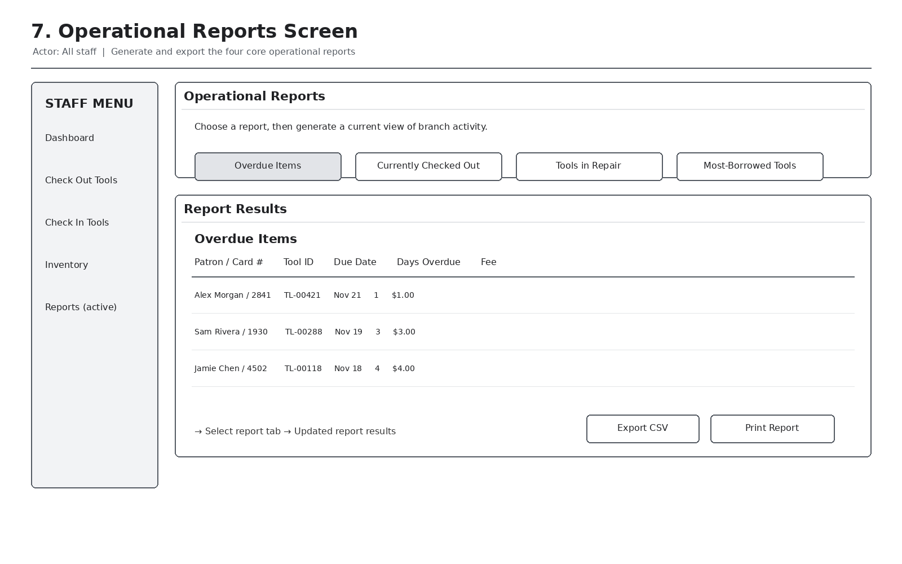

Joshua Samuel\
Talan Aria\
Brent Grossman

# Functional Specification: County Tool Library System

## 1. Overview
The software system requested by the County Library will enable adult patrons (18 and older) to browse inventory, manage waitlists, reserve tools, and view account statuses via a responsive, WCAG 2.1 AA-compliant web interface. While the platform operates independently from the existing book checkout system and supports future multi-location expansion, it integrates with the county's existing membership API for real-time library card validation and staff single sign-on. Library staff (Clerks, Catalogers, and Managers) will be able to verify patron IDs, process tool checkouts and returns, manage tool maintenance and kit inventories, collect late fees in person, and generate operational reports. The Tool Library platform will be hosted on county IT infrastructure/servers which is sized to support the library's existing base of ~100,000 cardholders (~5,000 monthly active users) and an initial catalog of ~50 tool types (~200 borrowable items). The Tool Library's operating schedule is 8 AM – 6 PM Mon–Sat, 10 AM – 5 PM Sun.

---

## 2. User Scenarios

### Patron Scenarios
1. **Online Browsing & Waitlist Reservation:** Sarah, an adult resident of the county, wants to tile her bathroom floor over the weekend. Using her smartphone, she visits the mobile-friendly Tool Library website and logs in using her existing county library card number—no separate account registration required. She filters the catalog by the "Masonry & Tile" category and sees that the wet tile saw is currently checked out with a waitlist of one person. She clicks "Join Waitlist" and receives an email confirmation via the county's existing notification system. Three days later, she receives a text alerting her that the saw is ready for pickup and that she has three days to claim it before her hold expires.
2. **In-Person Pickup & Electronic Waiver:** Sarah arrives at the Tool Library during operating hours to pick up her reserved wet tile saw. Because this is her first time borrowing a tool, she uses a local library kiosk to read and electronically sign the one-time liability waiver. She then walks up to the counter and presents her county library card and physical driver's license to Clerk Marcus. Marcus scans her card, verifies her 18+ resident status via the membership API, confirms her waiver is on file, scans the tile saw's internal barcode, and hands over the tool for a 14-day loan period.
3. **One-Time Renewal & Closed-Day Due-Date Shift:** David has a post-hole digger checked out for 14 days, originally due on a Tuesday. Before it becomes overdue, he calls the library to renew his rented equipment. The system verifies there are no active holds blocking his renewal, applies his one-time 14-day extension, and sees that the new due date lands on a scheduled library holiday. The system automatically pushes the due date forward to closing time on the next open business day.
4. **Waitlist Expiration & Queue Advancement:** Elena joins the waitlist for a high-demand cordless chainsaw. When the tool is returned, the system sends her an automated email/text alert that her 3-day pickup window has started. Elena gets busy with work and misses the deadline. At closing on the third day, the system automatically cancels her hold, removes her from the front of the queue, and sends a pickup notification to the next patron on the waitlist.
5. **Account Restriction & Overdue Book Isolation:** Tom walks up to the counter to borrow a sander while he has an overdue hammer from the Tool Library (past its 1-day grace period) and an overdue novel from the main County Library. When Clerk Marcus scans Tom's card, the system blocks the sander checkout due to the overdue tool and displays a $4.00 outstanding balance. Tom pays the $4.00 in person and returns the hammer; the system immediately lifts the Tool Library block and allows him to check out the sander, completely unaffected by his overdue library book.
6. **Ineligible Card Type Rejection:** A 16-year-old high school student with a valid County Library youth card attempts to log into the Tool Library website to reserve a soldering iron for a robotics project. When the system queries the County Membership API, it detects that the cardholder is under 18 and blocks the reservation, displaying a message explaining that tool borrowing is restricted to adult county residents aged 18 and older.
7. **5-Tool Checkout Limit Enforcement:** Maya already has five hand and power tools checked out on her account. She browses the catalog online and tries to join the waitlist for a sixth tool, and later asks a clerk at the desk to check out an additional wrench set. Both the web portal and the clerk's checkout screen block the sixth transaction, alerting her that she has reached the maximum limit of five concurrent tool loans.

### Staff Scenarios
1. **Clerk Return, Inspection & Late Fee Collection:** A patron walks into the library with a pressure washer that is two days past its adjusted due date. Clerk Marcus scans the pressure washer's barcode into the check-in screen. The system accounts for the 1-day grace period and automatically calculates a $3.00 late fee (at the $3/day high-demand tool rate). Marcus inspects the pressure washer kit against its attached inventory label, verifies all nozzles and hoses are present, and notices the trigger wand is leaking. He checks the "Needs Servicing" box, enters technician notes ("Leaking trigger wand"), and toggles the tool's status to "In Maintenance," which keeps the waitlist intact while preventing immediate re-borrowing. Finally, he collects the $3.00 fee in person and completes the check-in. Marcus then replenishes any depleted kit consumables (such as soaps) from the stock room.
2. **Cataloger Inventory Addition & Manager Role Administration:** A local contractor donates a brand-new cordless drill kit to the library. Cataloger Chloe logs into the employee portal using her existing county staff credentials. She navigates to the Inventory Management screen, enters the drill kit's details (categorizing it as a single kit item with its component list, replacement value, and standard $1/day late rate), generates and prints an internal barcode label, and sets its status to "Ready to Borrow." Later that afternoon, Store Manager Brenda logs in, navigates to the Staff Administration menu, and promotes Chloe's permissions to Manager so Chloe can onboard two newly hired part-time clerks next week.
3. **Phone/Desk Assisted Reservation:** A patron calls the Tool Library desk because they don't have internet access at home and asks to reserve a ladder. Clerk Marcus looks up the patron's library card in the staff portal, confirms their card is active and in good standing, and places them on the ladder's waitlist on their behalf.
4. **Lost Item Billing Ceiling & Replacement Liability:** A patron calls to report that a $120 laser level they borrowed three weeks ago was stolen from their garage. Clerk Marcus pulls up the patron's active loans and clicks "Mark Item Lost." Because the tool is unreturned rather than merely late, the system overrides the standard $20 late-fee cap and assesses the full $120 replacement value to the patron's account, locking their borrowing privileges until the replacement fee is paid in person (or potentially removed by a manager).
5. **Missing Kit Components at Check-In:** A patron returns a cordless impact driver kit, but when Clerk Marcus checks the contents against the laminated inventory list inside the case, the battery charger is missing. Marcus flags the missing component on the check-in screen, preventing the kit from returning to "Ready to Borrow" status, and notifies the patron that the kit cannot be cleared as complete until the charger is returned (or billed as a lost item).

---

## 3. Non-Goals
The following features and integrations are beyond the scope of the system and are not required for the solution:
- **Book Inventory Integration & Cross-Blocking:** The system will not manage book loans, nor will overdue books block tool checkouts (and vice versa).
- **Native Mobile Applications & Digital Cards:** Native iOS/Android apps and linking library cards to mobile wallets/phones are out of scope; the system relies strictly on a mobile-friendly web interface compatible with desktop browsers and Firefox.
- **Self-Checkout & Automated Handoffs:** Patrons cannot check out tools themselves; all physical hand-offs and returns must go through library staff.
- **Automated Online Fine Payments:** Integration with the existing online payment processor is excluded due to system separation; all late and lost-item fees are collected in person. Online payment can potentially be added in a later iteration.
- **Membership Fees, Deposits, or Training Tracking:** No extra deposits, tool membership fees, damage fees, or mandatory tool training certifications will be tracked or charged.
- **Standalone Consumables:** Consumables (e.g., sandpaper, blades) are only tracked as part of tool kits and are not loaned or tracked individually.

---

## 4. Use Case Diagram

---

## 5. Use Cases

| Use Case Name | Primary Actor(s) | Description |
| :--- | :--- | :--- |
| Browse Tool Catalog | Patron, Public User | Users view all tools across every category in the catalog. Each tool shows its current status (*Ready to Borrow*, *Checked Out*, or *In Maintenance*) along with a live waitlist count. |
| Filter Tool Catalog | Patron, Public User | Users narrow the catalog by tool name, category, type, and status (*Ready to Borrow*, *Checked Out*, *In Maintenance*) to find specific tools. Waitlist counts stay live in the filtered results. |
| Manage Reservations | Patron, Clerk | Patrons join or cancel waitlists for tools, either online or through staff. Once a patron reaches the front of the queue, they have 3 days to pick up the item. Clerks can also place waitlist reservations on a patron's behalf, in person or over the phone. |
| Manage Renewals | Patron, Clerk | Patrons may renew a loan one time. The renewal period matches the duration of the original loan. |
| Electronic Liability Waiver | Patron | First-time borrowers electronically sign a one-time liability waiver on a local kiosk or personal device. The waiver must be signed before any tool checkout can be finalized. |
| Patron Verification | Clerk | Staff verify the patron's photo ID and confirm active adult (18+) county resident status through the real-time Membership API. |
| Card Issuance | Clerk | Staff issue a new library card when the patron does not already have one. |
| Tool Checkout | Clerk, Cataloger, Manager | Staff scan the patron's card and up to 5 tool barcodes. The system enforces the checkout rules (waiver signed, no overdue or lost tools, under the 5-item cap) and sets due dates of up to 14 calendar days. A due date that lands on a closed day is shifted forward. |
| Tool Check-In | Clerk, Cataloger, Manager | Staff scan returned tools, verify kit contents against the inventory labels, and mark the items returned. Clerks replace simple kit consumables on return. Mechanical or electrical repairs are sent to tech staff. |
| Fee Assessment | Clerk, Cataloger, Manager | At check-in, the system applies a 1-day grace period that extends until closing on the next open day. It then calculates late fees ($1/day standard, $3/day high-demand), capped at the tool's replacement cost or $20. Staff record in-person payments. Patrons are financially liable for lost tools, while tools that are simply damaged are covered by the library. |
| Maintenance Tracking | Clerk, Cataloger, Manager | Staff flag tools that are not currently borrowed as *In Maintenance* or *Ready to Borrow* and log a repair description. Patrons stay on the waitlist while a tool is in maintenance. |
| Condition Tracking | Clerk, Cataloger, Manager | Staff record missing or damaged notes on a tool so its condition is documented. Patrons stay on the waitlist. Damage and loss are also recorded on the borrower's account and shown to the clerk at checkout. |
| Inventory Management | Cataloger, Manager | Staff add new tools or kits and assign each an internal barcoded ID. They set loan durations and replacement values, update tool metadata, and retire items that are lost or broken. |
| Donation Management | Cataloger, Manager | Staff add donated tools or kits to the inventory and assign each an internal barcoded ID. They also set the loan duration and replacement value for each donated item. |
| Staff Role Administration | Manager | Managers add or remove Clerks and Catalogers and modify staff permission levels, using existing county employee accounts. |
| Operational Reporting | Clerk, Cataloger, Manager | Staff generate and print or export reports for Overdue Items, Currently Checked Out Tools, Tools in Repair, and Most-Borrowed Tools. Historical records are retained indefinitely. |

---

## 6. UX Flow

---

## 7. User Screens

### **1. Patron Catalog & Account Screen**

The Patron Catalog screen displays the County Tool Library logo, location selector, search bar, and available tools. Patrons can filter tools by category, tool type, and availability, view loan durations and waitlist counts, and select Join Waitlist / Reserve. The My Account button opens an account drawer where patrons can view checked-out tools, renew eligible loans, cancel waitlist holds, check waiver status, and view outstanding late fees.

---

### **2. Staff Login Screen**

The Staff Login screen displays a centered authentication form with a County Employee ID / Username field and Password field. Staff enter their county credentials and select Sign In with County Credentials to authenticate through the County Membership & Auth API and access the staff dashboard.

---

### **3. Main Staff Dashboard Screen**

The Main Staff Dashboard displays the current location, operating hours, logged-in staff member, role, and system date and time. Staff can use the left navigation menu to access the Dashboard, Check Out Tools, Check In Tools, Inventory Management, and Reports, while Staff Admin is available only to Managers. The central workspace provides quick-action buttons for checking out and checking in tools, a live feed of expiring 3-Day Holds, a summary of tools currently in maintenance, and a patron lookup search bar for reserving tools on a patron's behalf.

---

### **4. Tool Check-Out Screen**

The Tool Check-Out screen allows staff to verify a patron using their library card barcode or manually entered card number. Staff can review the membership API status, verify photo ID, check electronic waiver status, review historical borrower notes, and check the patron's active loan count and checkout restrictions. Staff can then scan tools into the checkout cart, review internal barcode IDs, tool names, kit component reminders, and automatically calculated due dates before selecting Complete Checkout to finalize the transaction.

---

### **5. Tool Check-In & Maintenance Screen**

The Tool Check-In & Maintenance screen displays the scanned tool information, borrowing patron details, checkout date, due date, and kit contents checklist. Staff can identify missing kit components using the checklist, review automatically calculated late fees, mark fees as paid in person, or mark an item as lost. They can also select whether the tool is Ready to Borrow or In Maintenance, enter technician or damage notes, and select Complete Check-In to finish the return.

---

### **6. Inventory Management Screen**

The Inventory Management screen allows Catalogers and Managers to search and view the library's inventory of 200+ tools in a data table. Staff can review internal barcode IDs, tool names, categories, loan durations, replacement values, and statuses, as well as add new or donated tools through a form and print barcode labels.

---

### **7. Operational Reports Screen**

The Operational Reports screen allows staff to generate and view four reports: Overdue Items, Currently Checked Out, Tools in Repair, and Most-Borrowed Tools. Staff can select a report tab to display the corresponding information and export the results as a CSV file or print the report.
