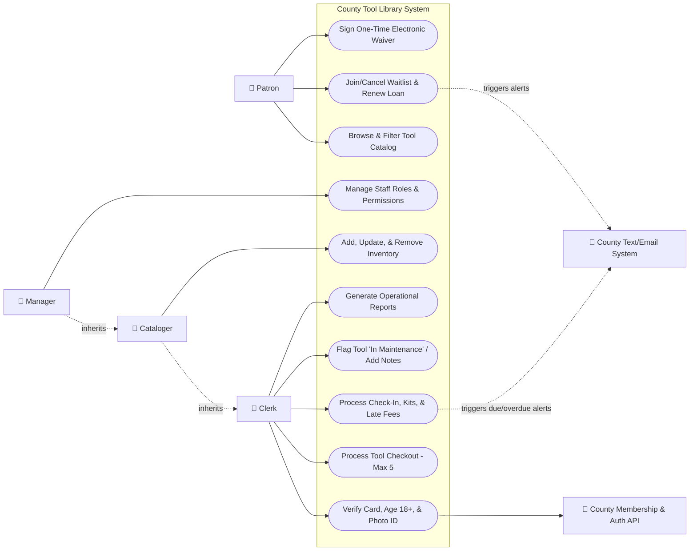
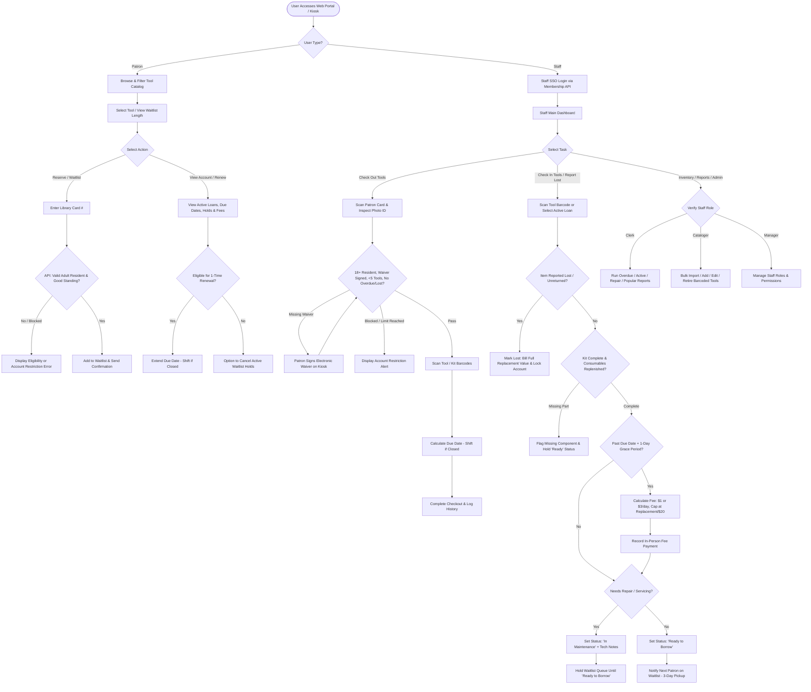

Joshua Samuel\
Talan Aria\
Brent Grossman

# Functional Specification: County Tool Library System

## 1. Overview
The software system requested by the County Library will enable adult patrons (18 and older) to browse inventory, manage waitlists, reserve tools, and view account statuses via a responsive, WCAG 2.1 AA-compliant web interface. While the platform operates independently from the existing book checkout system and supports future multi-location expansion, it integrates with the county's existing membership API for real-time library card validation and staff single sign-on. Library staff (Clerks, Catalogers, and Managers) will be able to verify patron IDs, process tool checkouts and returns, manage tool maintenance and kit inventories, collect late fees in person, and generate operational reports. The Tool Library platform will be hosted on county IT infrastructure/servers which is sized to support the library's existing base of ~100,000 cardholders (~5,000 monthly active users) and an initial catalog of ~50 tool types (~200 borrowable items). The Tool Library's operating schedule is 8 AM – 6 PM Mon–Sat, 10 AM – 5 PM Sun.

---

## 2. User Scenarios

### Patron Scenarios
1. **Online Browsing & Waitlist Reservation:** Sarah, an adult resident of the county, wants to tile her bathroom floor over the weekend. Using her smartphone, she visits the mobile-friendly Tool Library website and logs in using her existing county library card number—no separate account registration required. She filters the catalog by the "Masonry & Tile" category and sees that the wet tile saw is currently checked out with a waitlist of one person. She clicks "Join Waitlist" and receives an email confirmation via the county's existing notification system. Three days later, she receives a text alerting her that the saw is ready for pickup and that she has three days to claim it before her hold expires.
2. **In-Person Pickup & Electronic Waiver:** Sarah arrives at the Tool Library during operating hours to pick up her reserved wet tile saw. Because this is her first time borrowing a tool, she uses a local library kiosk to read and electronically sign the one-time liability waiver. She then walks up to the counter and presents her county library card and physical driver's license to Clerk Marcus. Marcus scans her card, verifies her 18+ resident status via the membership API, confirms her waiver is on file, scans the tile saw's internal barcode, and hands over the tool for a 14-day loan period.
3. **One-Time Renewal & Closed-Day Due-Date Shift:** David has a post-hole digger checked out for 14 days, originally due on a Tuesday. Before it becomes overdue, he calls the library to renew his rented equipment. The system verifies there are no active holds blocking his renewal, applies his one-time 14-day extension, and sees that the new due date lands on a scheduled library holiday. The system automatically pushes the due date forward to closing time on the next open business day.
4. **Waitlist Expiration & Queue Advancement:** Elena joins the waitlist for a high-demand cordless chainsaw. When the tool is returned, the system sends her an automated email/text alert that her 3-day pickup window has started. Elena gets busy with work and misses the deadline. At closing on the third day, the system automatically cancels her hold, removes her from the front of the queue, and sends a pickup notification to the next patron on the waitlist.
5. **Account Restriction & Overdue Book Isolation:** Tom walks up to the counter to borrow a sander while he has an overdue hammer from the Tool Library (past its 1-day grace period) and an overdue novel from the main County Library. When Clerk Marcus scans Tom's card, the system blocks the sander checkout due to the overdue tool and displays a $4.00 outstanding balance. Tom pays the $4.00 in person and returns the hammer; the system immediately lifts the Tool Library block and allows him to check out the sander, completely unaffected by his overdue library book.
6. **Ineligible Card Type Rejection:** A 16-year-old high school student with a valid County Library youth card attempts to log into the Tool Library website to reserve a soldering iron for a robotics project. When the system queries the County Membership API, it detects that the cardholder is under 18 and blocks the reservation, displaying a message explaining that tool borrowing is restricted to adult county residents aged 18 and older.
7. **5-Tool Checkout Limit Enforcement:** Maya already has five hand and power tools checked out on her account. She browses the catalog online and tries to join the waitlist for a sixth tool, and later asks a clerk at the desk to check out an additional wrench set. Both the web portal and the clerk's checkout screen block the sixth transaction, alerting her that she has reached the maximum limit of five concurrent tool loans.

### Staff Scenarios
1. **Clerk Return, Inspection & Late Fee Collection:** A patron walks into the library with a pressure washer that is two days past its adjusted due date. Clerk Marcus scans the pressure washer's barcode into the check-in screen. The system accounts for the 1-day grace period and automatically calculates a $3.00 late fee (at the $3/day high-demand tool rate). Marcus inspects the pressure washer kit against its attached inventory label, verifies all nozzles and hoses are present, and notices the trigger wand is leaking. He checks the "Needs Servicing" box, enters technician notes ("Leaking trigger wand"), and toggles the tool's status to "In Maintenance," which keeps the waitlist intact while preventing immediate re-borrowing. Finally, he collects the $3.00 fee in person and completes the check-in. Marcus then replenishes any depleted kit consumables (such as soaps) from the stock room.
2. **Cataloger Inventory Addition & Manager Role Administration:** A local contractor donates a brand-new cordless drill kit to the library. Cataloger Chloe logs into the employee portal using her existing county staff credentials. She navigates to the Inventory Management screen, enters the drill kit's details (categorizing it as a single kit item with its component list, replacement value, and standard $1/day late rate), generates and prints an internal barcode label, and sets its status to "Ready to Borrow." Later that afternoon, Store Manager Brenda logs in, navigates to the Staff Administration menu, and promotes Chloe's permissions to Manager so Chloe can onboard two newly hired part-time clerks next week.
3. **Phone/Desk Assisted Reservation & Damage History Check:** A patron calls the Tool Library desk because they don't have internet access at home and asks to reserve a ladder. Clerk Marcus looks up the patron's library card in the staff portal, confirms their card is active and in good standing, and places them on the ladder's waitlist on their behalf. Later that day, when another patron comes to check out a circular saw, Marcus notices an alert on the checkout screen showing two prior accidental damage notes on the patron's history; since damage is covered by the library and no items are currently overdue or lost, Marcus completes the checkout as normal.
4. **Lost Item Billing Ceiling & Replacement Liability:** A patron calls to report that a $120 laser level they borrowed three weeks ago was stolen from their garage. Clerk Marcus pulls up the patron's active loans and clicks "Mark Item Lost." Because the tool is unreturned rather than merely late, the system overrides the standard $20 late-fee cap and assesses the full $120 replacement value to the patron's account, locking their borrowing privileges until the replacement fee is paid in person (or potentially removed by a manager).
5. **Missing Kit Components at Check-In:** A patron returns a cordless impact driver kit, but when Clerk Marcus checks the contents against the laminated inventory list inside the case, the battery charger is missing. Marcus flags the missing component on the check-in screen, preventing the kit from returning to "Ready to Borrow" status, and notifies the patron that the kit cannot be cleared as complete until the charger is returned (or billed as a lost item).

---

## 3. Non-Goals
The following features and integrations are beyond the scope of the system and are not required for the solution:
- **Book Inventory Integration & Cross-Blocking:** The system will not manage book loans, nor will overdue books block tool checkouts (and vice versa).
- **Native Mobile Applications & Digital Cards:** Native iOS/Android apps and linking library cards to mobile wallets/phones are out of scope; the system relies strictly on a mobile-friendly web interface compatible with desktop browsers and Firefox.
- **Self-Checkout & Automated Handoffs:** Patrons cannot check out tools themselves; all physical hand-offs and returns must go through library staff.
- **Automated Online Fine Payments:** Integration with the existing online payment processor is excluded due to system separation; all late and lost-item fees are collected in person. Online payment can potentially be added in a later iteration.
- **Membership Fees, Deposits, or Training Tracking:** No extra deposits, tool membership fees, damage fees, or mandatory tool training certifications will be tracked or charged.
- **Standalone Consumables:** Consumables (e.g., sandpaper, blades) are only tracked as part of tool kits and are not loaned or tracked individually.

---

## 4. Use Case Diagram

---

## 5. Use Cases

| ID | Use Case Name | Primary Actor(s) | Description |
| :--- | :--- | :--- | :--- |
| **UC-01** | Browse & Filter Tool Catalog | Patron, Public User | Users view all tools across categories, filtering by name, category, type, and status (*Ready to Borrow*, *Checked Out*, *In Maintenance*), along with live waitlist counts. |
| **UC-02** | Manage Reservations & Renewals | Patron, Clerk | Patrons join or cancel waitlists online or via staff. Once at the front of the queue, patrons have 3 days to pick up the item. Patrons may also execute a one-time loan renewal matching the original loan duration. Clerks can place waitlist reservations on a patron's behalf (in person or over the phone). |
| **UC-03** | Electronic Liability Waiver | Patron | First-time borrowers electronically sign a one-time liability waiver on a local kiosk or personal device before any tool checkout can be finalized. |
| **UC-04** | Patron Verification & Card Issuance | Clerk | Staff verify patron photo ID, validate active adult (18+) county resident status via the real-time Membership API, or issue new library cards if needed. |
| **UC-05** | Tool Checkout | Clerk, Cataloger, Manager | Staff scan the patron's card and up to 5 tool barcodes. System enforces rules (waiver signed, no overdue/lost tools, under 5-item cap) and sets due dates (up to 14 calendar days, shifted forward if landing on a closed day). |
| **UC-06** | Tool Check-In & Fee Assessment | Clerk, Cataloger, Manager | Staff scan returned tools, verify kit contents via inventory labels, and mark items returned. System applies a 1-day grace period (extends until closing on the next open day), calculates late fees ($1/day standard, $3/day high-demand, capped at replacement cost or $20), and records in-person payments. Patrons are financially liable for lost tools while simply damaged tools are covered by the library. Clerks replace simple kit consumables upon return, while sending mechanical/electrical repairs to tech staff. |
| **UC-07** | Maintenance & Condition Tracking | Clerk, Cataloger, Manager | Staff flag unborrowed tools as *In Maintenance* or *Ready to Borrow*, logging repair descriptions or missing/damaged notes without dropping patrons from the waitlist. |
| **UC-08** | Inventory & Donation Management | Cataloger, Manager | Staff add new or donated tools/kits, assign internal barcoded IDs, set loan durations and replacement values, update metadata, or retire lost/broken items. |
| **UC-09** | Staff Role Administration | Manager | Managers add or remove Clerks and Catalogers and modify staff permission levels using existing county employee accounts. |
| **UC-10** | Operational Reporting | Clerk, Cataloger, Manager | Staff generate and print/export reports for Overdue Items, Currently Checked Out Tools, Tools in Repair, and Most-Borrowed Tools, retaining historical records indefinitely. |

---

## 6. UX Flow

---

## 7. User Screens (Wireframe Specifications)

### 1. Patron Public Catalog & Account Screen (Responsive Web)
* **Top Navigation Bar:** Displays the County Tool Library logo, location selector (future-proofing for multi-branch support), a global search bar, and a "My Account / Log In" button.
* **Filter Sidebar / Drawer:** Checkboxes and dropdowns to filter tools by **Category** (e.g., Woodworking, Plumbing, Lawn & Garden), **Tool Type**, and **Availability Status** (*Ready to Borrow*, *Checked Out*, *In Maintenance*).
* **Tool Catalog Grid:** Responsive card layout showing tool photo, item name, standard loan duration (e.g., 7 days or 14 days), current status badge, waitlist queue count (e.g., "2 people waiting"), and a primary **"Join Waitlist / Reserve"** button.
* **Patron Account Drawer/Modal:** Displays checked-out tools with adjusted due dates, a **"Renew Loan"** button (disabled if already renewed once or if waitlisted), active waitlist holds with a **"Cancel Hold"** button, electronic waiver status badge, and any outstanding late fees due at the desk.

### 2. Staff Login Screen
* **Layout:** Centered authentication card compliant with WCAG 2.1 AA contrast and keyboard navigation standards.
* **Elements:** County Employee ID / Username field, Password field, and a **"Sign In with County Credentials"** button authenticating directly against the County Membership & Auth API.

### 3. Main Staff Dashboard Screen
* **Left Side Navigation:** Vertical menu featuring **Dashboard** (active), **Check Out Tools**, **Check In Tools**, **Inventory Management** (visible to Catalogers/Managers), **Reports**, and **Staff Admin** (visible to Managers only).
* **Top Header:** Displays current location name, operating hours status, logged-in staff member's name and role badge, and live system date/time.
* **Central Workspace:** Quick-action tiles for **Check Out** and **Check In**, a live feed of **Expiring 3-Day Holds** awaiting pickup, a summary widget of **Tools Currently in Maintenance**, and a quick-lookup search bar to reserve tools on a patron's behalf.

### 4. Tool Check-Out Screen
* **Left Side Navigation:** Persistent navigation rail.
* **Patron Verification Panel (Top):** Input field for barcode scanner (or manual card number entry), real-time API status readout (**Valid Adult Resident**), **Photo ID Verified** confirmation checkbox, **Electronic Waiver Signed** indicator (with a button to push the waiver prompt to the patron kiosk), and historical borrower notes (past loss/damage counter).
* **Active Loan & Restriction Banner:** Displays current active tool count (e.g., `2 / 5 Tools Checked Out`) and blocks checkout if overdue items, lost items, or unpaid fees exist.
* **Checkout Cart (Bottom):** Barcode scan input for tools/kits, itemized list showing internal ID, tool name, kit component reminder, and auto-calculated due date, finalized by a **"Complete Checkout"** button.

### 5. Tool Check-In & Maintenance Screen
* **Left Side Navigation:** Persistent navigation rail.
* **Tool & Loan Summary Panel:** Displays scanned tool barcode, name, borrowing patron details, checkout date, due date, and a prominent **Kit Contents Checklist** (e.g., *"Verify: 1x Drill, 2x Batteries, 1x Charger, 1x Case"*) **Missing Kit Component(s)** checkbox/flag alongside the Kit Contents Checklist.
* **Fee Calculation & Payment Box:** Automatically displays days overdue past the 1-day grace period, applicable daily rate ($1/day or $3/day), capped fee total (never exceeding replacement value or $20), a **"Mark Paid In-Person"** button, and a **"Mark Item Lost"** option.
* **Condition & Maintenance Panel:** Radio toggle between **"Ready to Borrow"** and **"In Maintenance"**, a text area for **Technician / Damage Notes**, and a primary **"Complete Check-In"** button.

### 6. Inventory Management & Reporting Screens
* **Inventory Management (Cataloger/Manager):** Searchable data table of all 200+ items with columns for Internal Barcode ID, Tool Name, Category, Loan Duration, Replacement Value, and Status. Includes an **"+ Add New / Donated Tool"** modal form and a **"Print Barcode Label"** action.
* **Operational Reports (All Staff):** Tabbed interface allowing one-click generation and CSV/Print export of the four core reports: **Overdue Items**, **Currently Checked Out**, **Tools in Repair**, and **Most-Borrowed Tools**.
